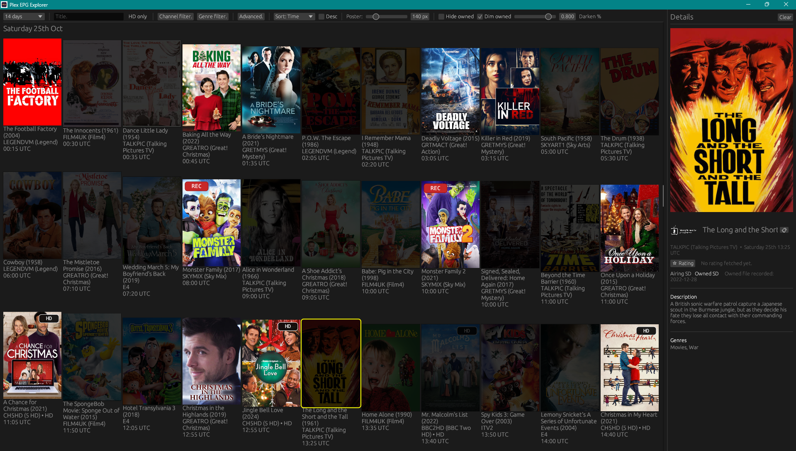

# Pex – Plex EPG Explorer



If you're old-fashioned like me and still enjoy flicking through the next week of TV films, this project is for you. Pex is my personal way to dig through two weeks of Plex DVR listings, decide what to record, and—most importantly—see which airings I already own in Plex, all in a super-visual grid.

Pex helps you:
- Browse up to 14 days of film listings in the Plex EPG with a poster-forward layout.
- Choose to visually dim movies you already own or hide them from the grid entirely.
- Spot HD airings, including HD upgrades for titles you currently only have in SD.
- See at a glance which films are already scheduled to record in Plex.
- Bring channel art, genre groupings, and on-demand TMDb ratings (click the ⭐ button in the detail pane) into the experience while keeping everything cached locally for speedy, offline-friendly launches.

To get rolling, extract the portable ZIP and launch PEX. **Connect to Plex** lets you choose your Plex Databases folder (including Windows network shares), select a guide, and optionally enable owned-library scanning. No copied config or separate SQLite installation is required. Existing configs and manually supplied local databases remain supported.

Because the app is written in Rust, it runs on Windows, Linux, and macOS, and it's easy to tweak. Grab the code, point your favourite AI at the included primer, and you'll have a head start on customising things for your own setup—especially if your filenames don't follow the `Title (Year)` pattern the app expects today.

---

### Why I built it

- This started as a personal project: each week I sift through upcoming TV movies to decide what to record.
- The stock Plex web UI felt too barebones for that workflow, so I wanted a richer experience for anyone in the Plex community who still enjoys browsing broadcast schedules.
- While the app concentrates on TV films, the bundled SQLite explorer tools make it easy for others to tweak or extend it for different Plex data.
- Developed primarily on Windows 11 with WSL Fedora 42; both environments are exercised regularly. macOS hasn't been tested first-hand, but the Rust/egui stack produces native binaries for both x86_64 and ARM64, so it should run wherever those architectures are supported (Intel/AMD).

---

## Downloads & Releases

- Releases live on the [GitHub Releases page](https://github.com/AnicetusCer/pex/releases); each tagged version includes portable bundles.
- Use the scripts in `make_portable/` to produce fresh zips before a release; the outputs land in `make_portable/dist/` ready for upload.
- On Windows run `pwsh ./release_windows.ps1 -Version 1.2.5` to build, tag, push, package, and publish/update the GitHub release with the Windows bundle.
- On Linux (including WSL) run `pwsh ./release_linux.ps1 -Version 1.2.5` to do the same for the Linux bundle. Each script can safely rerun and will add or replace only its platform’s asset.
- Release helpers also upload `checksums-<platform>-<tag>.txt` so each zip can be verified after download.
- Generated binaries are not checked into git; attach them to the corresponding GitHub release instead.

---

## Verify Downloads

Each release includes:
- `pex-portable-<platform>-<tag>.zip`
- `checksums-<platform>-<tag>.txt`

Verify the zip against the published checksum file before running.

### Windows (PowerShell)

```powershell
$zip = "pex-portable-windows-x86_64-v1.2.5.zip"
$checksums = "checksums-windows-x86_64-v1.2.5.txt"

$line = Get-Content $checksums | Where-Object { $_ -like "*`*$zip" } | Select-Object -First 1
if (-not $line) { throw "No checksum entry found for $zip" }
$expected = ($line -split " ")[0].ToLowerInvariant()
$actual = (Get-FileHash $zip -Algorithm SHA256).Hash.ToLowerInvariant()

if ($expected -eq $actual) { "OK: checksum matches." } else { "ERROR: checksum mismatch." }
```

### Linux

```bash
sha256sum -c checksums-linux-x86_64-v1.2.5.txt
```

Expected output: `...zip: OK`

---

## Table of Contents
- [Downloads & Releases](#downloads--releases)
- [Verify Downloads](#verify-downloads)
- [Overview](#overview)
- [Prerequisites](#prerequisites)
- [Getting Started](#getting-started)
- [Configuration Reference](#configuration-reference)
- [Data & Cache Locations](#data--cache-locations)
- [Typical Workflows](#typical-workflows)
- [Troubleshooting & Diagnostics](#troubleshooting--diagnostics)
- [Development Notes](#development-notes)
- [Legal](#legal)

---

## Overview

Highlights:

- 🚀 **Fast start-up** – poster and channel artwork are cached and uploaded on
demand, keeping the UI responsive even on large guides.
- 🗂️ **Powerful filtering** – search, day-range slicing, HD-only toggle, channel
and genre selectors, plus multiple sort orders.
- **Owned library awareness** - mirrored Plex library data feeds owned/HD badges and "recorded on" timestamps directly into the grid.
- 🎯 **DVR awareness** – scheduled recordings show a red *REC* badge and detail call-out pulled from the Plex library database.
- 🎨 **Detail-rich panels** – long-title scroller with copy button, channel
badges, optional TMDb ratings, and formatted descriptions.
- 🧰 **Operator controls** – quick refresh/clear actions for poster and owned caches as well as worker tuning knobs.

Pex runs on Windows, macOS, and Linux (including WSL) using
[egui/eframe](https://github.com/emilk/egui) for the native UI.

---

## Repository Layout

- `src/`
  - `main.rs` / `lib.rs` – launch the egui app and wire tracing.
  - `config.rs` – parses `pex-config.json` (or `~/.pex-config.json`), and exposes helper paths for the copied databases.
  - `app/`
    - `mod.rs` – central application state, message pump, advanced actions, and egui integration.
    - `prep.rs` – copies the Plex databases (daily freshness), queries poster rows, and emits `PrepMsg`.
    - `prefetch.rs` / `gfx.rs` – background workers + GPU upload helpers for poster textures.
    - `cache.rs` / `prefs.rs` – cache directory helpers, poster/file pruning, persisted UI preferences.
    - `owned/` – Plex-library scanners that build owned sidecars for fast restarts.
    - `scheduled.rs` – loads scheduled DVR entries from `media_grabs`, `media_subscriptions`, and `metadata_subscription_desired_items`.
    - `detail.rs`, `filters.rs`, `types.rs`, `utils.rs` – UI panels, filtering & sorting logic, shared structs, and formatting helpers.
    - `ui/` – splash/grid/top bar egui widgets.
  - `assets/` – embedded icon and other compile-time resources.
  - `bin/` – optional CLI entry-points used during development.
- `epg_explorer_tool/`
  - `db_explorer.rs` – CLI for poking at the EPG SQLite.
  - `library_db_explorer.rs` – companion CLI for the Plex library database (owned + DVR state).
  - `*_ai_primer.yaml` – primers that document how the helpers should be extended.
- `make_portable/` – scripts and template config for packaging a portable build.
- `db/` – working copies of the Plex databases (populated on first run).
- `.pex_cache/` – generated cache directory (posters, owned sidecars, UI prefs).
- `config.example.json` – starter configuration; copy to `pex-config.json` for local runs.

---

## Prerequisites

### Plex data access
- Plex DVR/EPG must be enabled so that `tv.plex.providers.epg.cloud-*.db` (and
the accompanying WAL/SHM files) exist on disk.
- Common locations:
  - **Windows:** `%LOCALAPPDATA%\Plex Media Server\Plug-in Support\Databases`
  - **Linux (service install):** `/var/lib/plexmediaserver/Library/Application Support/Plex Media Server/Plug-in Support/Databases`
  - **Docker:** bind the Plex config volume; copy the database out via the host.
- Pex expects a working copy in `db/plex_epg.db`. You can supply it manually or point `plex_epg_db_source` at the live Plex database so Pex pulls in a fresh copy once per day.

### Toolchain
- Rust toolchain with Cargo (the 1.2.5 builds use Rust 1.94)
- Git (to clone the repository)

### External services
- **TMDb ratings** are optional. The guide works without a key. To use online film ratings, enter your personal TMDb v3 API key in PEX.

---

## Getting Started

For a portable download, extract into a writable folder and launch `pex.exe` on Windows (or `./pex` on Linux). **Connect to Plex** appears on an unconfigured install. Browse to the server's `Plug-in Support/Databases` folder, or paste a UNC path and choose **Find databases**. Select a guide when several are listed. Choose **Guide only** to skip owned and scheduled-recording badges, then **Save and load guide**. Settings are saved automatically; a TMDb key is optional.

Choose **Set up ratings…** on **Connect to Plex**, or click **⭐ Rating** in a film’s details. If you need a key, the **TMDb ratings key** window accepts it in a masked field. **Save key** stores the key in your active config and resumes a lookup started from film details. Use **Advanced → Ratings key…** at any time to replace the key or select **Remove key**. **Cancel** closes the window without saving. The portable ZIP preserves your saved `pex-config.json` on upgrade.

A live owned refresh checks the library and its write-ahead log (WAL) twice before transferring them. If they look stable, PEX copies them once, checks for changes and validates them locally. If Plex is busy, PEX keeps its usable local mirror. When there is no usable mirror, it can use an existing completed dated backup alongside the library. The guide shows the source and date used for owned and recording badges, and offers **Retry owned scan**.

If completed backups already exist, choose **Completed snapshots** in **Connect to Plex** and select their folder. PEX checks for a newer backup on refresh and reuses its validated local mirror when the backup is unchanged. Both modes need only read access to a local directory or mounted/network share. [Portable setup instructions](make_portable/README.md#refresh-from-completed-snapshots)

For development:

```sh
git clone https://github.com/AnicetusCer/pex.git
cd pex
cargo run --release --locked
```

The application resolves portable data beside the executable. Set `PEX_BASE_DIR` to a writable test folder to exercise a clean install without using your normal data. Use fixture databases rather than a live Plex database for development.

---
## Configuration Reference

Pex reads config in this order: `PEX_CONFIG` (if set), `pex-config.json` next to the app/current directory, then `~/.pex-config.json` (Windows/Linux/macOS home). Legacy `config.json` is still accepted for backward compatibility. All keys are optional unless otherwise stated; absent keys fall back to reasonable defaults.

| Key | Type | Default | Description |
| --- | --- | --- | --- |
| `plex_epg_db_source` | string or `null` | `null` | When set, Pex copies the live Plex EPG SQLite file into `db/plex_epg.db` no more than once every 24 hours. Leave unset if you manage `db/plex_epg.db` yourself. |
| `plex_library_db_source` | string or `null` | `null` | Live Plex library used for `db/plex_library.db`. PEX refreshes the mirror on a 24-hour cadence or when you choose **Refresh owned scan**. Leave unset if you manage the local mirror yourself. |
| `library_snapshot_dir` | string or `null` | `null` | Use existing completed library backups from this directory for owned/recording badges. The live library path can stay configured. |
| `guide_only` | boolean | `false` | Skip owned scanning and recording badges, including a manually supplied local library. |
| `cache_dir` | string or `null` | `.pex_cache` | Root folder for poster caches, owned sidecars, and UI prefs. |
| `tmdb_api_key` | string or `null` | `null` | Optional personal TMDb v3 API key for on-demand film ratings. Manage it in **Advanced → Ratings key…**. |
| `log_level` | string | `info` | Sets the default tracing level when `RUST_LOG` is unset. Controls tracing output (`trace`, `debug`, `info`, `warn`, `error`). |

Example configuration:

```json
{
  "plex_epg_db_source": "\\\\nas\\PlexConfig\\Databases\\tv.plex.providers.epg.cloud.db",
  "plex_library_db_source": "\\\\ds\\PlexMediaServer\\AppData\\Plex Media Server\\Plug-in Support\\Databases\\com.plexapp.plugins.library.db",
  "cache_dir": ".pex_cache",
  "tmdb_api_key": "YOUR-TMDB-KEY",
  "log_level": "info"
}
```

> Tip: on Linux paths use forward slashes; on Windows double any backslashes in
JSON strings or switch to forward slashes.

### Database copy settings

- `plex_epg_db_source` – path to `tv.plex.providers.epg.cloud*.db` on the Plex
  server. Pex copies it into `db/plex_epg.db` (refreshing at most once every 24 h).
- `plex_library_db_source` – path to
  `com.plexapp.plugins.library.db`. Pex clones it into
  `db/plex_library.db` and uses it for owned detection and DVR badges.

You can locate these files by:

| Platform | Default location |
| --- | --- |
| **Windows (desktop)** | `%LOCALAPPDATA%\Plex Media Server\Plug-in Support\Databases\` |
| **Windows (service account)** | Check the configured Plex data folder for the account running the server. |
| **macOS** | `~/Library/Application Support/Plex Media Server/Plug-in Support/Databases/` |
| **Linux** | `/var/lib/plexmediaserver/Library/Application Support/Plex Media Server/Plug-in Support/Databases/` |
| **NAS appliances** | Use the Plex data directory for the installed package and DSM/OS version, then open `Plug-in Support/Databases`. |
| **Docker** | Whatever host path you bind to `/config/Library/Application Support/Plex Media Server/Plug-in Support/Databases/` |

Map the server path to a readable client path when PEX runs on another machine. A custom Plex backup directory can be shared independently from the guide directory. [Plex data directory locations](https://support.plex.tv/articles/202915258-where-is-the-plex-media-server-data-directory-located/)

### Other useful keys

- `cache_dir` – move the poster/owned/UI cache elsewhere; relative paths are resolved from the executable directory (or `PEX_BASE_DIR` when set).
- `log_level` – override the default tracing verbosity (`trace` → most verbose).

### Environment variables

- `PEX_DISABLE_PREFETCH=1` – skip poster downloads (useful when testing offline modes).
- `RUST_LOG=info` (or `debug`) – surface prep/owned/scheduled traces in the terminal.

---

## Data & Cache Locations

- `db/plex_epg.db` — working copy of the Plex EPG database (plus WAL/SHM files
  created on demand).
- `db/plex_library.db` — optional working copy of Plex’s library database, populated from the selected live library or snapshot folder.
- DVR metadata (`media_grabs`, `media_subscriptions`, `metadata_subscription_desired_items`) is read from `db/plex_library.db` to drive the *REC* badge and owned detection.
- `.pex_cache/` — posters, channel icons, owned sidecars, and UI
  preference files. Poster images older than 14 days are pruned automatically
  on startup.
- `db/` and `.pex_cache/` are created automatically; you can relocate caches by
  setting `cache_dir` in the config file.

---

## Typical Workflows

### First run (cold start)
1. Launch PEX and select your Plex Databases folder in **Connect to Plex**.
2. Select a guide and choose whether to enable the owned scan.
3. Click **Save and load guide**.
4. Let the initial owned scan and poster prefetch finish (progress appears in
the status bar). Large libraries may take several minutes.

### Daily usage
- Launch the app; the UI resumes where you left off.
- If `plex_epg_db_source` or `plex_library_db_source` is set, Pex checks once per
  day whether the respective database copy needs refreshing.
- Scheduled recordings sync automatically after poster prep; queued movies show a red *REC* badge in the grid and detail panel.
- Owned and HD badges stay up-to-date thanks to scanning the mirrored Plex library database.

### Keeping the owned cache fresh
- Use **Advanced ▸ Refresh owned scan** after adding/removing many files.
- On the first run after upgrading from 1.2.3, Pex scans the library and writes a new owned cache automatically.

### Poster cache maintenance
- **Advanced ▸ Clear & rebuild poster cache** wipes cached artwork and immediately restarts prefetching.

### Building a portable package
See [`make_portable/README.md`](./make_portable/README.md) for instructions on
producing a self-contained ZIP using the provided PowerShell/Bash scripts.

---

## Troubleshooting & Diagnostics

- **Status bar stuck on Stage 2/4 (DB copy):** verify the `plex_epg_db_source` and
  `plex_library_db_source` paths are reachable and readable.
- **Owned scan never completes:** check the Advanced panel for the latest message. In snapshot mode, verify that the client can read the selected folder and that it contains a completed library backup. In live mode, verify the configured library path.
- **REC badge missing:** confirm `plex_library_db_source` is configured, the copied `db/plex_library.db` contains up-to-date `media_subscriptions` rows, and you restarted after scheduling the recording.
- **Missing posters:** confirm outbound network access to the artwork URLs and
  that the cache directory is writable. Pex prunes posters older than 14 days
  automatically, so re-open the app after a while to fetch fresh artwork.
- **HD badge looks wrong:** rescan the owned library from **Advanced ▸ Refresh owned scan** after updating your Plex library database.
- **Logging:** set `log_level` to `debug` and relaunch to capture richer logs in
  the console.

---

## Development Notes

- Format the code with `cargo fmt`.
- Run tests with `cargo test`.
- Optional: `cargo clippy --all-targets -- -D warnings` (requires the Clippy
  component).
- DB inspection helpers:
  - `cargo run --bin db_explorer metadata_items 10`
  - `cargo run --bin library_db_explorer -- --tables`

---

## Legal

- Licensed under the [PEX Attribution License (PAL)](./LICENSE).
- TMDb ratings are fetched via the TMDb API; please respect their usage terms
  and attribution requirements.
- Plex is a registered trademark of Plex, Inc. This project is an independent
  client that reads the Plex DVR database.
- Additional third-party notices are listed in [`NOTICE`](./NOTICE).
